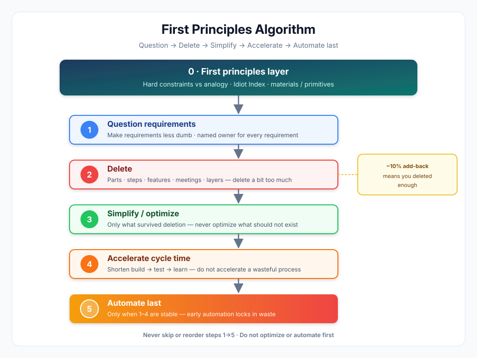

# First Principles Algorithm



An agent skill that applies **first-principles reasoning** plus Musk’s ordered **five-step engineering algorithm** (question → delete → simplify → accelerate → automate last). Tone: design review, not biography fan. Does **not** default to overtime culture or psychological-safety rejection.

## When to use

- A product, process, or architecture feels overcomplicated, expensive, or slow
- Inherited requirements are treated as sacred
- The team is optimizing or automating too early
- You want to rebuild from hard constraints (physics, law, real information limits) instead of industry habit

## When not to use

- Legal / compliance / safety floors are not yet separated from optional process
- People decisions where empathy or psychological safety is the goal
- Everyday incremental tweaks where a full first-principles rebuild is overkill

## Install

```bash
npx skills add chenqing/first-principles-algorithm --skill first-principles-algorithm
```

Or copy `skills/first-principles-algorithm/SKILL.md` into your agent’s skills folder.

## First principles (layer 0)

Separate **hard constraints** from **analogy / “everyone does it this way.”**

- Ask what is almost certainly true (physics, materials, true information limits)
- Rough **Idiot Index** when cost-heavy: finished cost ÷ raw-material cost — a high ratio often means process waste
- Battery-style check: what are the primitives and their market prices?

## The five steps (never skip or reorder)

1. **Question requirements** — Make them less dumb. Every requirement needs a **named person** (not “Legal” as a blob). Even smart people’s requirements are fair game.
2. **Delete** — Parts, process steps, features, meetings, layers. Delete a bit too much; if you later add back **under ~10%**, you probably deleted enough.
3. **Simplify / optimize** — Only what survived deletion. Forbidden: optimizing something that should not exist.
4. **Accelerate cycle time** — Shorten build → test → learn. Do not accelerate a wasteful process.
5. **Automate last** — Only when 1–4 are stable. Early automation locks in waste.

Deliverable: one table — Requirement → Delete → Simplify → Accelerate → Automate — plus risks (mistaken deletion, compliance, morale, measurement gaps).

## Anti-patterns (do not teach)

- Fabricated “Musk’s 10 laws” / “10x everything” quote packs
- Viral lines without primary sources
- Equating the algorithm with hardcore overtime culture
- Treating first principles as “ignore all experience always”

## Sources (prefer these)

- [Everyday Astronaut Starbase interview](https://everydayastronaut.com/starbase-tour-and-interview-with-elon-musk/) (~2021) — five-step oral source
- [Kevin Rose *Foundation*](https://elonmuskarchive.org/video/foundation-kevin-rose-2012-09-08) (2012) — first principles + battery example
- [WIRED / Chris Anderson](https://www.wired.com/2012/10/ff-elon-musk-qa/) (2012) — rocket materials ~2% of sale price
- [USC Commencement](https://elonmuskarchive.org/video/usc-commencement-2014-05-16) (2014) — first principles for new work
- Walter Isaacson, *Elon Musk* (2023), ~pp. 284–286 — algorithm + named owners + corollaries
- [Lex Fridman #438](https://lexfridman.com/elon-musk-and-neuralink-team-transcript/) (~2024) — restated mantra

## License

MIT
